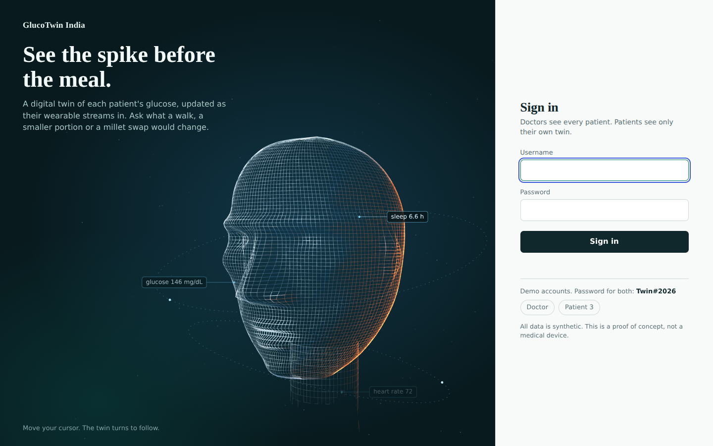
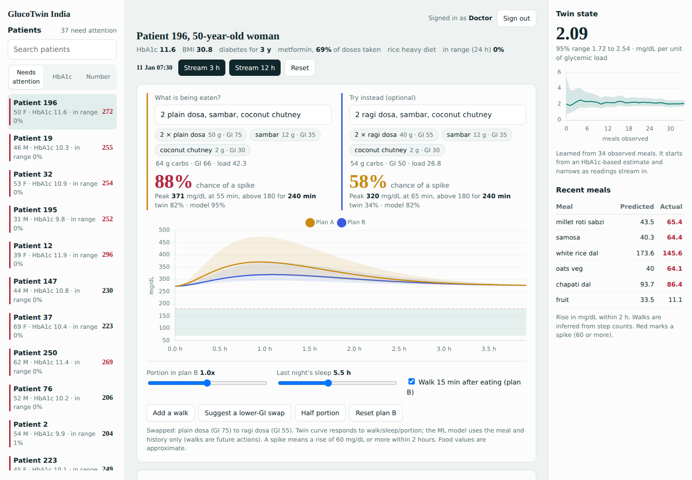

# GlucoTwin India: a digital twin for post-meal glucose spikes in type 2 diabetes

> Happiest Health **Digital Twin Challenge 2026** submission.

## Team
| | |
|---|---|
| Team name | **Byte01** |
| Team leader | Sreya M Nambiar |
| Members | Sreya M Nambiar (solo entry) |
| Year and branch | 4th year, CSE (Cybersecurity) |
| College | Sri Sairam Institute of Technology |
| Repository folder | `Byte01_Sri Sairam Institute of Technology` |

## Problem statement and use case
Type 2 diabetes (T2D) is one of India's biggest chronic conditions, and the pattern that hurts most is the **post-meal spike**: rice, idli, dosa and roti based meals, often eaten late, push glucose far above range for hours. A doctor sees an HbA1c every three months. They do not see the meal-by-meal picture.

**GlucoTwin** is a proof-of-concept digital twin of one T2D patient. It fuses
1. **static data**: a simulated health record (demographics, labs, genotype, adherence, diet), and
2. **dynamic data**: a simulated wearable stream (CGM glucose, heart rate, steps, sleep) plus a meal log,

to predict, **at the moment a meal is logged, whether glucose will spike in the next 2 hours**, and to let a doctor ask "what if?" (swap white rice for millet, walk for 15 minutes, eat half the portion, sleep better) before the patient eats.

Adverse event predicted: a post-meal rise of **at least 60 mg/dL** within 2 hours of a logged meal. Predicted peak, time above 180 mg/dL and a probability are shown for each plan.

## What is in the prototype
| Component | What it does |
|---|---|
| `data/generate.py` | Synthetic India-calibrated cohort: 300 patients x 14 days, 5-min CGM, HR, steps, sleep, meal log (27 Indian meals with carbs and glycemic index). EHR traits drive insulin resistance, so the two streams are genuinely coupled. Includes sensor dropouts, unlogged meals, unlogged snacks or stress bumps, and a hidden per-patient sensitivity that is **not** in the record. |
| `models/spike_model.py` | LightGBM spike classifier and rise regressor, patient-level train/val/test split, meal-time features only (no leakage), baselines, calibration table. |
| `models/ablation.py` | Fusion ablation: meal only vs +EHR vs +wearables vs both. |
| `twin/foods.py` | Free-text food entry: 117 Indian foods and plates with approximate carbs and GI. Understands quantities (`2 idli`, `1.5 cup rice`), several items (`rice with dal and curd`), typos (`idly`), custom carbs (`pizza 40 g`), and lower-GI swaps. Unknown foods are reported, never guessed. |
| `twin/engine.py` | The twin. State is the patient's response gain, estimated with a Kalman filter from an HbA1c-based prior and updated after every observed meal. Includes the what-if simulator with uncertainty band. |
| `twin/evaluate.py` | Replays each patient chronologically with no peeking; compares the live twin to a static twin and to the average. |
| `api/main.py` | FastAPI service with a streaming cursor (`/advance`) so the twin updates as the "wearable feed" arrives. |
| `api/auth.py` | Roles, signed sessions, scrypt check, login throttling, audit log. |
| `dashboard/pages/login.html` | Sign-in page with the interactive digital-twin hero. |
| `dashboard/pages/index.html` | Dashboard. Doctor: ranked patient worklist (search, sort, "needs attention" flags), typeable meal box with suggestions, plan A vs plan B forecast, twin state, recent meals, 36 h timeline, collapsible model evidence and access log. Patient: only their own twin and the same what-if tool. |

## Sign-in and roles


The login hero is a 3D wireframe head generated entirely in code (no model files). It turns left and right in real perspective to follow your cursor, lit by a cool key light and a warm rim light, with orbiting scanner rings and readouts pinned to the head. It lowers its own quality on slow machines and shows a still pose for users who prefer reduced motion.

| Role | Demo login | Can do |
|---|---|---|
| Doctor | `doctor` | See the whole cohort, what-if tool, model evidence and the access log |
| Patient | `patient3` (any `patient<id>`) | See only their own twin and what-if tool. No cohort, no model internals |

Password for both demo accounts: `Twin#2026` (override with `GLUCOTWIN_DEMO_PASSWORD`).

**Access control built in** (`api/auth.py`): scrypt password check that always runs (no timing hint for unknown users), HMAC-signed expiring session cookie (`HttpOnly`, `SameSite=Lax`), role and ownership checks on every `/api` route (a patient gets 403 on another patient's record), login throttling (5 failures, then a 60 s lock), an audit trail of sign-ins and record views (`audit.log`, shown to doctors), and security headers (`nosniff`, `X-Frame-Options: DENY`, `no-store`). 19 automated tests cover access control, the food parser, typed what-ifs, the doctor worklist, and live ingestion.

**Honest scope:** this is access control for a proof of concept. The demo accounts share one password hash computed at startup, sessions end when the server restarts unless `GLUCOTWIN_SECRET` is set, and HTTPS is not configured (set `COOKIE_SECURE=1` behind HTTPS). It is not a claim of DPDP or HIPAA compliance. The data is synthetic.

## Dashboard


A doctor opens the worklist (the top 15% of patients by a risk score of time in range, spikes and current glucose are flagged), picks a patient, **types the meal** (for example `2 plain dosa, sambar, coconut chutney`) and compares **plan A** (as typed) with **plan B** (a different meal, smaller portion, post-meal walk). `Suggest a lower-GI swap` fills plan B automatically. The twin keeps sharpening as the simulated wearable feed streams in (`Stream 3 h` / `Stream 12 h`).

**Food values are approximations.** Carbs and GI for the 117 foods are rounded, literature-style estimates for typical servings, not a clinical food table. GI changes with variety, cooking and what the food is eaten with.

## Results (all synthetic, patient-level held-out)
**Spike prediction at meal time** (45 test patients, 2,082 meals, 46.5% spikes):

| Model | AUROC |
|---|---|
| HbA1c only | 0.580 |
| CGM level and trend only | 0.593 |
| Glycemic load of the meal only | 0.857 |
| Fused LightGBM (meal + EHR + wearables/CGM) | **0.872** (AUPRC 0.858, Brier 0.146) |

**Fusion ablation** (mean of 5 seeds): meal only 0.856 -> + EHR 0.868 -> + wearables/CGM 0.869 -> both 0.871. Each stream adds about 1 to 1.5 AUROC points. **Meal composition dominates in this data**, and we say so plainly. Calibration is good: predicted vs observed spike rates by quintile are 0.05/0.05, 0.19/0.21, 0.41/0.45, 0.69/0.70, 0.90/0.92.

**Twin** (180 other patients, replayed chronologically, after 10 observed meals):

| Predictor of the 2 h rise | MAE (mg/dL) | Spike AUROC |
|---|---|---|
| Predict the average | 35.9 | n/a |
| Fused LightGBM (static, 45 test patients) | 24.6 | 0.872 |
| Twin with HbA1c estimate only | 24.8 | 0.854 |
| **Live twin** | **21.4** | **0.892** |

The twin's estimate of each patient's response gain is off by a median **19%** at the HbA1c starting point and **9%** after about 44 observed meals (measurable only because the data is synthetic and the true value is known).

## Honest limitations
- **Synthetic data only.** Numbers show the pipeline works. They are **not** clinical accuracy, and the generator's equations are our own literature-inspired assumptions, not validated clinical values.
- The twin's model structure resembles the generator's, which favours it. The LightGBM and twin rows use different patient subsets (45 vs 180).
- `OBS_BIAS` in `twin/engine.py` was calibrated on patients 0-119, and twin metrics use patients 120-299 only. `PROCESS_SD` was set low because synthetic physiology is stationary; real patients drift.
- The ML model cannot see a *planned* walk (future action), so walk and sleep what-ifs come from the twin. Their effect sizes (25% lower excursion with a walk, +8% response per hour below 7 h sleep) are priors.
- No hypoglycemia is modelled (reasonable for metformin-only patients, not for insulin or sulfonylurea users).
- The dashboard has been rendered and clicked through in headless Chromium (desktop and mobile), but not tested with real clinicians.
- The what-if curve starts from the patient's current glucose and returns to it, so "minutes above 180" reads as the whole window when the patient is already above 180.
- `/api/ingest` is an in-memory demo overlay; readings are not persisted across
  server restarts and the single-reading meal update is not a clinical sensor
  adjudication.
- Not a medical device. Do not use for treatment decisions.

## Data sandbox compliance
No real patient data. The EHR and wearable streams are generated by our own code (`data/generate.py`, seed 42), which the rules allow ("synthetic datasets", "generate their own synthetic time-series data"). Synthea and MIMIC-IV are not used. Static fields: demographics, diabetes duration, HbA1c, eGFR, LDL, triglycerides, TCF7L2 risk alleles, family history, metformin and adherence. The record has no other diagnoses.

## Run it
```bash
docker compose up --build        # builds the cohort, trains, evaluates, serves on http://localhost:8000
```
or without Docker:
```bash
pip install -r requirements.txt
sh scripts/run_all.sh             # generate -> sanity check -> train -> ablation -> twin evaluation
uvicorn api.main:app --port 8000  # dashboard at http://localhost:8000, API docs at /docs
pytest -q                         # 19 tests: security, food parser, what-if, triage, ingestion
```

## Updates after the demo video

The demo video shows the original interface and production model. The following
additive updates were made afterward without changing the dashboard layout,
meal-entry flow, model features, reported metrics, or synthetic-data scope:

- **Live ingestion:** doctors can POST a wearable reading to
  `/api/ingest`; it accepts glucose, heart rate, steps, sleep, and an optional
  meal, writes an audit event, and updates the existing per-patient Kalman twin.
  See `scripts/simulate_wearable.py` for a local stream simulator.
- **Extended synthetic record:** `data/generate_extended.py` writes a separate
  `data/extended_synthetic` record with hypertension, dyslipidemia, CKD stage,
  prior cardiac event, RMSSD, and light/deep/REM sleep percentages.
  `scripts/extended_ablation.py` writes a separate ablation report and never
  replaces the production LightGBM artifacts.
- **Open-data validation:** skipped honestly because a suitable downloadable,
  meal-linked public CGM dataset was not available in this environment.

Run the additive pieces:
```bash
python data/generate_extended.py
python scripts/extended_ablation.py
python scripts/simulate_wearable.py --patient 3
```

## Tech stack
Python 3.12, NumPy, pandas, PyArrow, LightGBM, scikit-learn, FastAPI, Uvicorn,
vanilla JS with Canvas 2D (procedural 3D head on the login page), Chart.js
(vendored, works offline), Docker, and standard-library wearable ingestion
simulation. The extended record and ablation are separate from production
artifacts.

## Architecture
See [`docs/architecture.pdf`](docs/architecture.pdf) (PNG copy in `docs/architecture.png`).

## Submission resources
- **Demo video (YouTube):** https://youtu.be/r13WZvbwSfg
- **Presentation (PDF/PPT):** https://drive.google.com/file/d/1xX2rJdyVV95gCdUvYmfCSFotszI8IiGI/view?usp=sharing
- **Architecture diagram:** [`docs/architecture.pdf`](docs/architecture.pdf) and [`docs/architecture.png`](docs/architecture.png)
- **Open-source license:** MIT, see [`LICENSE`](LICENSE).
- **Public repository:** https://github.com/sreyamnambiar/GlucoTwin
- **Access note:** the repository, demo video, presentation, and architecture files must be
  set to public or “anyone with the link” so reviewers can open them without additional
  permissions.

## Challenge checklist

This README includes the required submission details:

- **Team details:** Team Byte01; Sreya M Nambiar; solo entry.
- **College/incubator information:** Sri Sairam Institute of Technology; 4th year CSE (Cybersecurity); no incubator affiliation is claimed.
- **Project title:** GlucoTwin India.
- **Problem statement:** post-meal glucose spikes in type 2 diabetes are described in the problem statement section.
- **Healthcare use case:** meal-time spike prediction and what-if planning for doctors and patients are described in the problem statement and dashboard sections.
- **Technical stack:** Python, FastAPI, LightGBM, scikit-learn, NumPy, pandas, PyArrow, Uvicorn, vanilla JavaScript, Canvas 2D, Chart.js, and Docker.
- **AI/ML model details:** LightGBM classifier/regressor, meal-time features, patient-level split, calibration, ablation, and Kalman-filter twin details are documented above.
- **Demo video:** YouTube link is provided above.
- **Open-source license:** MIT license link is provided above.
- **Architecture diagram:** PDF and PNG files are provided in `docs/`.
- **Presentation:** Google Drive presentation link is provided above.
- **Synthetic-data disclaimer:** all records are synthetic; this is a proof of concept, not a medical device.
- **Public accessibility:** submission links must be configured for public access without additional permissions.

## License
MIT. See [`LICENSE`](LICENSE).
